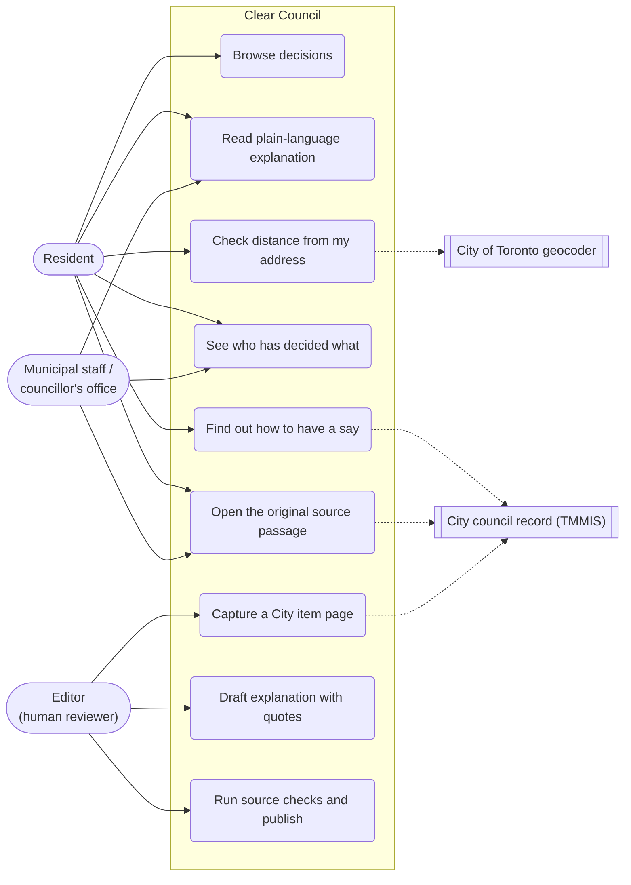
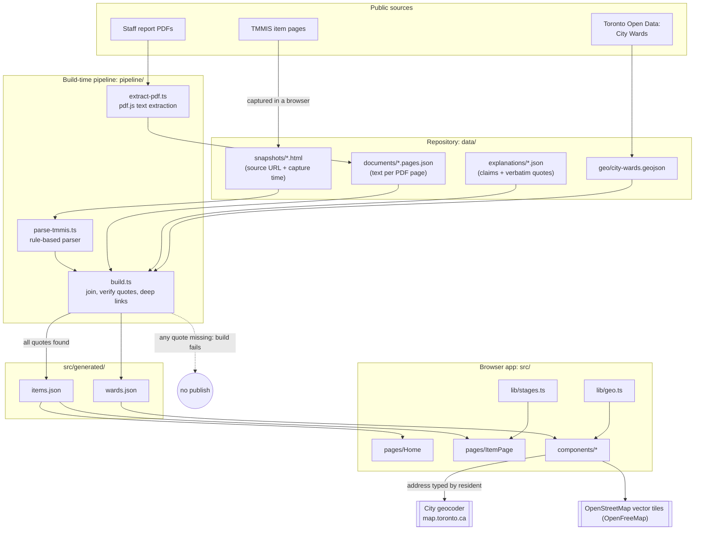
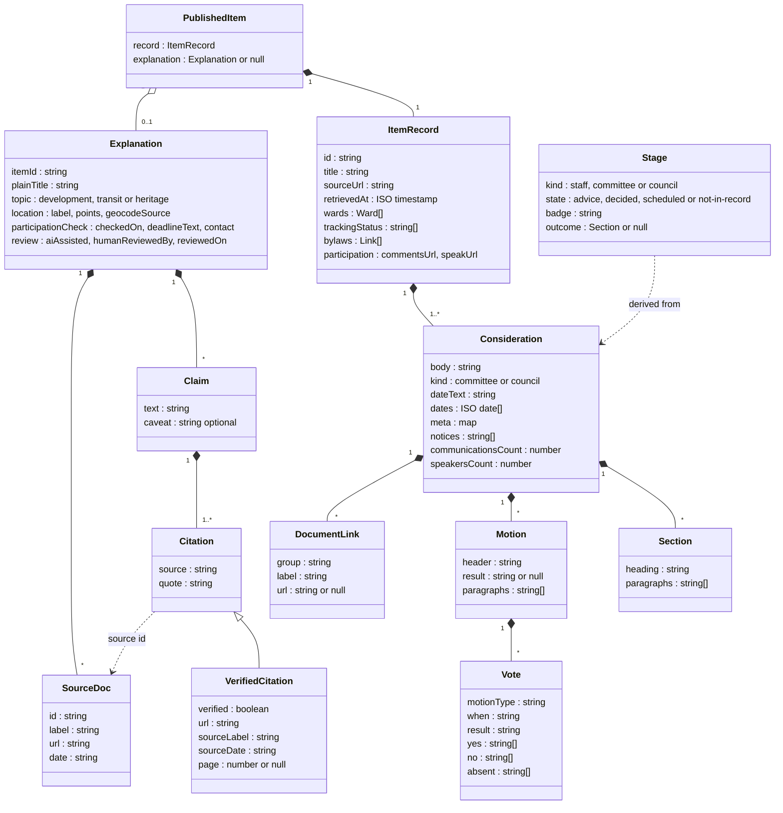
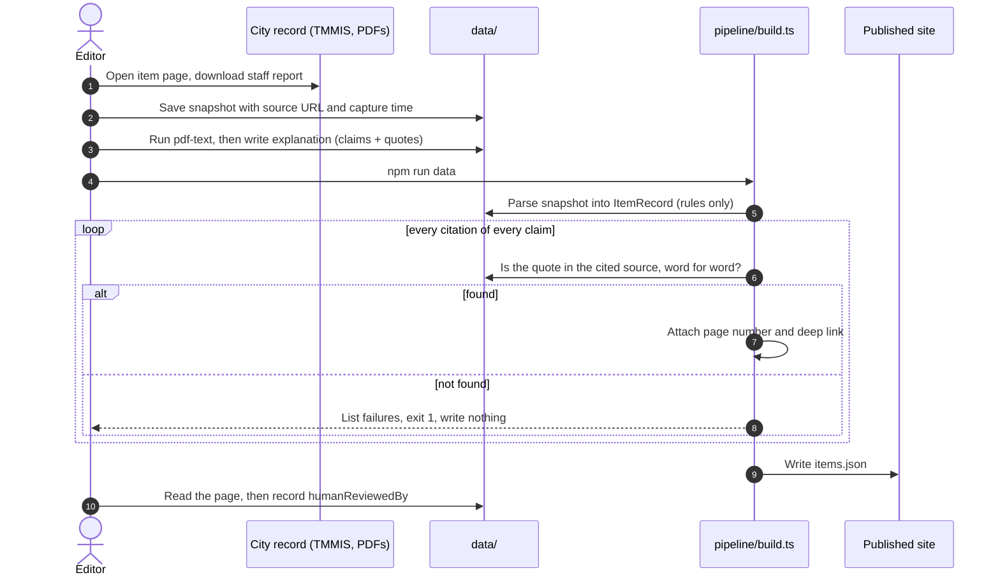
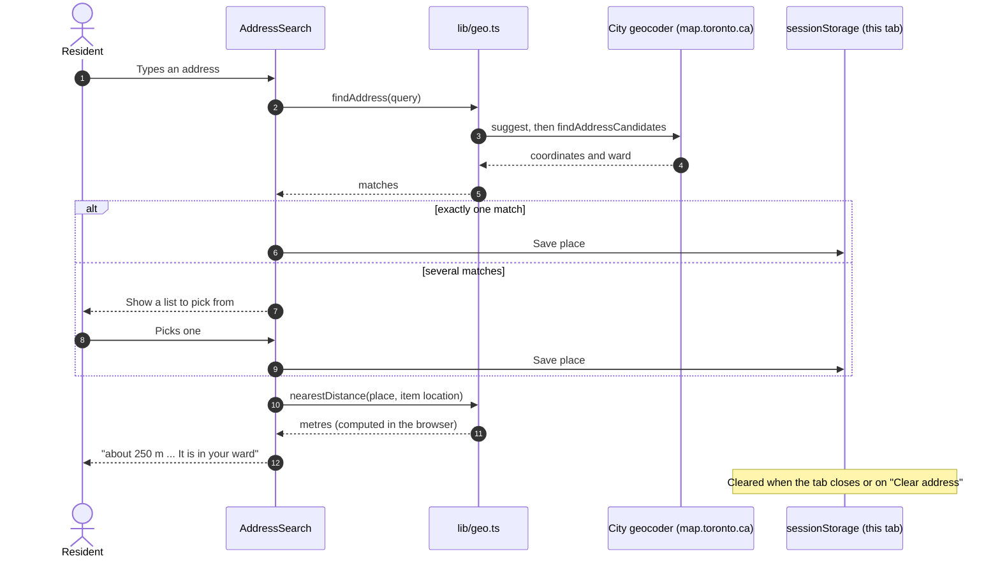
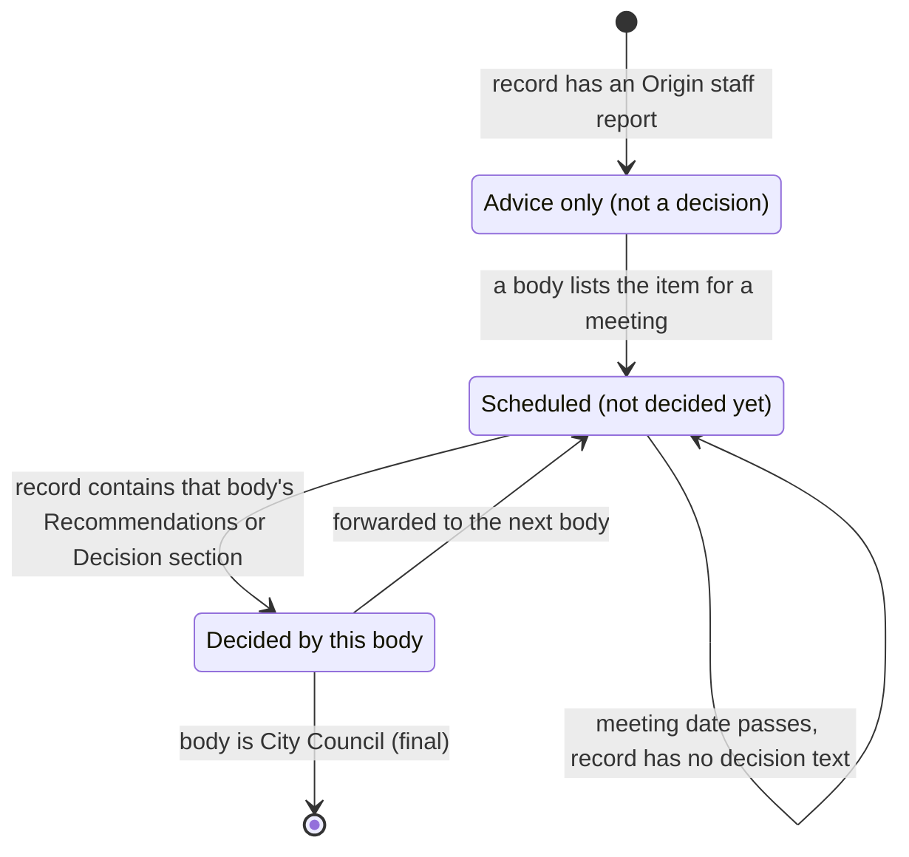
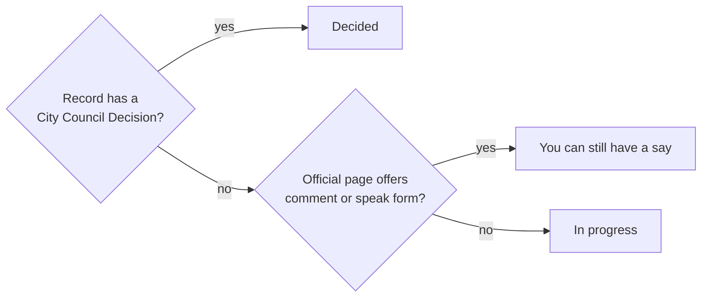
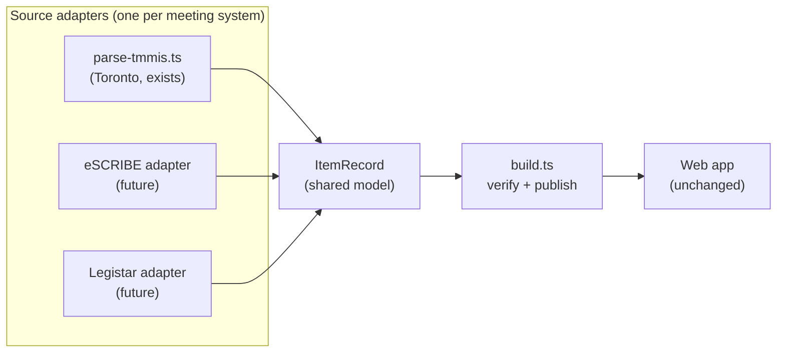

# Clear Council — Software Design

This document covers requirements, UML diagrams, architecture rationale, scalability, a
walk-through of the source code (including which parts were AI-assisted) and references.
Diagrams are written in Mermaid and render directly on GitHub.

Contents: [1 Requirements](#1-requirements) · [2 Use cases](#2-use-cases) ·
[3 Architecture](#3-architecture) · [4 Data model](#4-data-model-class-diagram) ·
[5 Behaviour](#5-behaviour) · [6 Design rationale](#6-design-rationale) ·
[7 Scalability](#7-scalability-and-adapting-to-another-municipality) ·
[8 Code walk-through](#8-source-code-walk-through) · [9 Testing](#9-testing-and-verification) ·
[10 AI-assisted code](#10-ai-assisted-code) · [11 References](#11-references)

---

## 1. Requirements

### 1.1 Users

| User | What they need |
|---|---|
| **Resident** (primary; includes renters, newcomers, youth, seniors, people with lower literacy or limited English) | Understand one proposal quickly, know if it is near them, know if they can still act |
| **Clerk / communications / engagement staff** | A way to explain an item that stays accurate and tied to the record |
| **Councillor's office** | A short, correct summary they can pass to constituents |
| **Community groups, journalists** | The exact wording, votes and sources behind a summary |

### 1.2 Functional requirements

Each requirement is traced to the challenge brief and to the code that implements it.

| ID | Requirement | Brief | Implemented in |
|---|---|---|---|
| F1 | Show in plain language what is proposed and why | "What is being proposed, and why" | `data/explanations/*.json`, `components/Claim.tsx` |
| F2 | Show where it applies, and its distance from an address the resident chooses | "Is this near me?" | `components/CityMap.tsx` (home page), `components/ItemMap.tsx`, `components/AddressSearch.tsx`, `lib/geo.ts` |
| F3 | Show staff recommendation, committee outcome and Council decision as separate steps | "Distinguish staff recommendations, committee decisions and final council decisions" | `lib/stages.ts`, `components/StageTracker.tsx` |
| F4 | Show whether and how the resident can still take part | "Key dates, and how and when to have a say" | `components/HaveYourSay.tsx` |
| F5 | Never state a deadline unless it was read from the official page | "Do not infer a submission deadline from a meeting date" | `participationCheck.deadlineText` in `types.ts`; `HaveYourSay.tsx` |
| F6 | Give the source passage, document, date and link for every statement | "A link back to the source document for every claim" | `pipeline/build.ts` (`verify`), `components/Claim.tsx` |
| F7 | Block publication of any statement whose quote is not found in its source | "A summary that mis-states a decision is worse than no summary" | `pipeline/build.ts` (exit code 1) |
| F8 | Keep conditions, amendments and open questions visible | "Summaries must preserve important conditions and uncertainty" | `conditionsAndUnknowns`, `Claim.caveat` |
| F9 | Show motions and recorded votes, labelled by motion | Dataset caveat: "a vote may concern an amendment" | `pipeline/parse-tmmis.ts` (`parseMotions`), `StageTracker.tsx` |
| F10 | Show the capture date of the record on every page | "Show the source and date for each explanation" | `ItemPage.tsx` (provenance line) |
| F11 | Read an item page aloud, highlighting each section as it is read | Residents "with lower literacy or limited English" (users, 1.1) | `components/ResidentTools.tsx`, `lib/speech.ts`, `lib/voices.ts` |
| F12 | Put an upcoming meeting in the resident's calendar, labelled as a meeting date and not a deadline | "Key dates" without inferring a deadline (F5) | `lib/calendar.ts` (only scheduled, undecided, future dates) |
| F13 | Explain the decision process itself, stop by stop, with sourced facts and the real items at each stop | "Making municipal decisions easier to understand" | `pages/HowItWorks.tsx`, `content/civics.ts` |
| F14 | Explain City Hall words in plain language, in a glossary and in place on item pages | Same | `pages/Words.tsx`, `components/Term.tsx`, `content/civics.ts` |
| F15 | Show everything for one ward, by address or from a list | "Is this near me?" | `pages/MyWard.tsx` |
| F16 | Show how the site checks itself, with live numbers from the published data | "Show the source and date for each explanation"; AI transparency (N7) | `pages/HowWeCheck.tsx` |

### 1.3 Non-functional requirements

| ID | Requirement | How it is met |
|---|---|---|
| N1 | **Accuracy over coverage** | Items without a verified explanation show the official record only |
| N2 | **Privacy / data minimisation** | Residents' names from correspondence are dropped at parse time. The typed address goes only to the City's own geocoder and lives in `sessionStorage` for the tab. No accounts, cookies or analytics |
| N3 | **Accessibility** | Semantic HTML, skip link, visible focus, 18 px base text, colour contrast chosen for WCAG 2.2 AA, native `
` for disclosure, map facts repeated as text, mobile-first layout |
| N4 | **Neutral tone** | Explanations describe; staff opinions are labelled as opinions; no adjectives of approval |
| N5 | **Usable without the team** | Static site, no login, no configuration. `npm run data && npm run dev` |
| N6 | **Low cost to run** | No server, no database, no AI calls at run time. Any static host works |
| N7 | **Transparency about AI** | Each page states which parts are rule-based and which were AI-drafted, and whether a person signed off. *How we check* summarises it for the whole site |
| N8 | **Security** | Content-Security-Policy allowing only the map tiles and the City geocoder; every data link must be `https` to a City of Toronto host (checked at build and at render); geocoder replies validated with a timeout; saved state shape-checked; CI on every pull request; Dependabot. See `SECURITY.md` |
| N9 | **Languages** | Interface in English, French and Chinese, including screen-reader labels and the map library's own controls (passed through its `locale` option). Explanations and City records stay in English, because each sentence is checked word for word against the City's English record; that content is marked `lang="en"` so a screen reader pronounces it as English. A test fails on any untranslated interface string |
| N10 | **Works offline once visited** | A service worker saves the app page and every built script, style and Latin font at install (the build writes the list into `sw.js`), under a cache name that changes with each build. It touches only its own caches, because the host's other sites share the origin. Map tiles and the geocoder are never cached. A banner says what needs a connection |
| N11 | **Motion and maps** | All map motion (fly-to, orbit, tour, pulse) stops when the system asks for reduced motion. The map library loads after the text |

### 1.4 Out of scope for this prototype

Translated explanations (only the interface is translated; see N9), notifications, automatic
ingestion of new items, an editing interface for staff, and a phone channel. Section 7 describes
how each would be added.

---

## 2. Use cases

---

## 3. Architecture

Clear Council has two halves that share one data model:

- a **build-time pipeline** (Node.js) that turns saved City records into a checked JSON file, and
- a **static web app** (React) that renders that file in the browser.

There is no server and no database.

---

## 4. Data model (class diagram)

Defined once in [`src/types.ts`](../src/types.ts) and imported by both halves.

Two points worth noticing:

- **`ItemRecord` has no place to put a resident's name.** `communicationsCount` and
  `speakersCount` are numbers. Privacy is a property of the schema, not of a filter that
  might be skipped.
- **`Stage` is not stored.** It is computed from `ItemRecord` every time, so the timeline can
  never drift from the record.

---

## 5. Behaviour

### 5.1 Publishing an item (sequence)

### 5.2 "Is this near me?" (sequence)

### 5.3 How a step's status is decided (state diagram)

A step moves to *decided* only when the City record contains that body's own decision text.
Today's date is never compared with a meeting date.

Overall item status (`itemStatus` in `lib/stages.ts`):

---

## 6. Design rationale

| Decision | Alternatives considered | Why this one |
|---|---|---|
| **Quotes checked by code, not by a second AI** | Ask a model to grade the summary; trust the draft | A substring test cannot be persuaded. It gives a yes/no answer a clerk can audit, and it runs in milliseconds for free. It does not prove the paraphrase is fair, which is why human sign-off is a separate, visible field |
| **Explanations generated ahead of time, then checked** | Generate live for any item on request | The brief says a wrong summary is worse than none. Ahead-of-time means nothing reaches a resident unchecked, the site needs no API key or budget, and it works under load. Cost: new items need an editor |
| **Stages derived from the record by rules** | Let the model describe the process | The staff / committee / Council distinction is the brief's first hard constraint. Rules give the same answer every time and are covered by tests |
| **Static site, no backend** | Server-rendered app with a database | A municipality can host it anywhere, including on its existing web server. Nothing to patch, nothing storing personal data |
| **Saved snapshots with capture time** | Fetch the City page live | A page can show exactly which version of the record it explains. The City site also does not permit scripted downloads, and we did not try to get around that |
| **City's own geocoder for addresses** | Commercial or third-party geocoder | The resident's address goes only to the City, which already holds address data. No third party learns who looked up what |
| **MapLibre GL JS + OpenStreetMap vector tiles (OpenFreeMap)** | Google photorealistic 3D tiles; Leaflet (flat, used at first) | A tilted 3D view with buildings at their recorded heights, with no API key, billing or account, and an open licence. Google's 3D tiles need an API key tied to a billing account. Cost: a larger bundle and a WebGL requirement, so the page falls back to text when WebGL is missing |
| **Proposed height drawn as a plain block** | Model the building; draw nothing | Residents judge a proposal by how it compares with what is there. The record gives storeys, not an outline, so the block uses only the storey count, which the build checks against a quoted passage, and the page says the shape is not real |
| **Text beside every map** | Map only | Screen-reader users and people on slow connections get the same facts |
| **Hash-based routing** | History API routing | Works on any static host without rewrite rules |
| **One shared `types.ts`** | Separate schemas for pipeline and app | The compiler catches any mismatch between what is written and what is read |

### What the quote check does and does not guarantee

- **Guarantees**: every source passage shown to a resident exists, word for word, in the cited
  document, on the cited page, and the link goes there.
- **Does not guarantee**: that the plain-language sentence is a fair reading of the passage, or
  that nothing important was left out. Those need a person, so `review.humanReviewedBy` is
  shown on every page and is empty until someone signs.

---

## 7. Scalability and adapting to another municipality

### 7.1 More items

| Concern | Now (3 items) | At 3,000 items |
|---|---|---|
| Data file | One 73 kB `items.json` bundled with the app | Split into one JSON per item plus a small index; load an item on demand. The build already produces records one at a time |
| Build time | Under 1 second | Linear. Parsing is about 10 ms per item; quote checking is substring search |
| Finding things | A short list | Add client-side search over the index, and filter by ward using the ward already in each record |
| Authoring | By hand | See 7.3 |

### 7.2 Another city

Only one module knows about Toronto's page layout. Everything after the parser works on
`ItemRecord`.

What a second municipality would change:

1. **Adapter**: write a parser for its meeting system that outputs `ItemRecord`. Many Ontario
   municipalities use eSCRIBE or Legistar, so one adapter serves many cities.
2. **Stage vocabulary**: the status-to-plain-words table in `lib/stages.ts` (about ten lines).
3. **Geography**: its ward boundary file and its geocoder URL in `lib/geo.ts`.
4. **Participation rules**: who to contact and how comments are handled.

Nothing in the React components is Toronto-specific.

### 7.3 Keeping up with a live council calendar

A pilot inside a municipality would replace manual capture with the city's own feed:

1. The meeting system publishes or exports new items (first-party access, no scraping).
2. The adapter produces `ItemRecord`s automatically; the official-record view is live at once,
   because it needs no explanation.
3. A model drafts an explanation **with quotes**; `build.ts` rejects any draft whose quotes fail.
4. A clerk or communications officer reviews the draft in a simple editing screen and signs it.
5. If the City page changes after capture, a nightly re-capture flags the item as "record
   changed since this explanation was checked".

Steps 3 to 5 are not built. The verification gate they depend on is.

---

## 8. Source code walk-through

About 1,600 lines of TypeScript. Every file has a header comment stating its purpose.

### 8.1 Pipeline (`pipeline/`)

**`parse-tmmis.ts`** — the City page parser.

- `parseTmmisItem(html)` reads the capture header, loads the HTML with cheerio, and maps each
  accordion card (`#agenda-item-accordion > .card`) to a `Consideration`. The City lists the
  newest first; the array is reversed so the model is chronological.
- `parseConsideration` walks every `<h4>` in a card. The heading text decides the handler:
  *Background Information* becomes document links, *Communications* and *Speakers* become
  counts only, *Motions* go to `parseMotions`, anything else becomes a verbatim `Section`.
- A Council card repeats the committee's correspondence under *Communications (Community
  Council)*. The parser counts a group only on the card of the body it belongs to, so input is
  not double-counted.
- `parseVoteTable` reads the result, the note that says which motion the vote was on, and the
  yes / no / absent names (elected officials, a public role).
- `parseDates` and `parseWards` are small regular-expression helpers; ward names can contain
  " - " themselves (*Parkdale - High Park*), which the look-ahead handles.

**`extract-pdf.ts`** — opens each PDF with pdf.js and joins text items into one string per page.
Keeping pages separate is what lets a citation link to `#page=N`.

**`build.ts`** — the gate.

- `norm` collapses whitespace so line breaks in a PDF do not cause false failures. It does not
  change wording, punctuation or case.
- `verify` looks for the normalised quote in each page of the cited source. If found it records
  the page and builds the link; if not, the claim is added to `failures`.
- `textFragment` builds a `#:~:text=start,end` link so the browser scrolls to and highlights
  the passage on the City page.
- A claim with zero citations is also a failure.
- If `failures` is non-empty the script prints them and exits with code 1 **before** writing
  `items.json`. There is no flag to skip this.
- Finally it thins the ward polygons (every fourth vertex, five decimal places) from 1.1 MB to
  about 130 kB for the map.

### 8.2 App (`src/`)

**`lib/stages.ts`** — `buildStages(record)` produces the timeline: a staff step from the
*Origin* line, one step per `Consideration`, and a placeholder if Council is not in the record
yet. `outcomeOf` treats a step as decided only if the card has a section whose heading ends in
*Recommendations* or *Decision* (other than the staff *Recommendations*). `STATUS_WORDS`
translates the City's status codes; unknown codes are shown as written instead of guessed.

**`lib/geo.ts`** — `distanceMetres` is the haversine formula. `nearestDistance` handles routes:
it projects the line to a local flat plane around the resident's point and takes the shortest
perpendicular distance to any segment. `formatDistance` rounds to 50 m so the result does not
look more exact than a single address point justifies. `findAddress` calls the City geocoder's
`suggest` then `findAddressCandidates` endpoints.

**`lib/place.tsx`** — a React context holding the chosen address, mirrored to `sessionStorage`
with try/catch so the app still works where storage is blocked.

**`components/RouteStrip.tsx`** — draws the stages as a transit-style route, full size on the item
page and as a row of dots on list cards. `currentIndex` (in `lib/stages.ts`) picks the stop the
item is waiting at. **`components/AtAGlance.tsx`** gives four short answers at the top of the
page; its "What" line reuses the first source-checked claim instead of adding new text.

**`components/Claim.tsx`** — one sentence, an optional "Keep in mind" caveat, and a native
`
` listing each quote with its document, page, date and link.

**`components/HaveYourSay.tsx`** — three branches from `itemStatus`. In the *open* branch the
deadline row shows `participationCheck.deadlineText` if a person recorded one, otherwise states
that the City's page gives none and that the tool will not derive one. It also warns that
comments become public records, which the City states on its comment form.

**`components/StageTracker.tsx`** — renders stages as an ordered list with the official wording
and votes behind `
`. Each vote carries a note that it may be on an amendment.

**`lib/map3d.ts`** — shared 3D map setup: MapLibre map tilted 58° and turned 17° to match
Toronto's street grid, ward outlines, route lines, markers, and `addProposedHeights`, which
draws one square block per proposed building at `storeys × 3 m`. `build.ts` refuses a storey
count that does not appear as "N-storey" in a checked quote under *What is being proposed*.

**`components/ItemMap.tsx`** — the item page's 3D map, created in an effect and removed on
cleanup: site marker or route line, ward outline, height block and the resident's marker.
Cooperative gestures are on, so one finger scrolls the page and two move the map.

**`components/CityMap.tsx`** — the home page's 3D map of the whole city. Choosing a marker flies down to street level. One marker per decision,
drawn like the stops of the route strip and coloured by status; a streetcar route is a line with
a marker at its middle. Choosing a marker (click, Enter or Space) tells the page which decision
to summarise. The map is built once per language (the map library reads its button labels only
when built); the resident's address and the chosen marker are applied by separate effects so the
map is not rebuilt. Orbit pauses while the camera is flying, because setting the bearing would
cancel the flight; the guided tour ends as soon as the selection differs from the one it made, so
a person's own choice always wins. When the summary card overlaps the map on a wide
screen, the map pans so the chosen marker stays visible. Every marker has a spoken name, and
the same decisions are listed beside the map, so nothing depends on using the map.

**`lib/safe.ts`** — the trust boundary. `isSafeLink` accepts only `https` links to an allowlisted
City of Toronto host; `findUnsafeLinks` walks the published data so `npm run data` can refuse a
bad link; `safeHref` is used on every data-driven link in the app. `isTorontoPoint` rejects
coordinates outside the city.

**`lib/mapTheme.ts`** — Day, Dusk and Night. The base style is restyled layer by layer from a
small palette (land, water, parks, roads, labels, buildings), with matching light and sky. Each
original paint value is remembered before the first change, so Day restores the style exactly.
Our own layers (ids starting `cc-`) are never restyled.

**`lib/map3d.ts` (additions)** — `addProposedHeights` now draws one slab per storey inside a faint
shell, floors first (a shell drawn first hides the floors through the depth test).
`clearViewBearing` scores the four street-grid directions by the tall existing buildings between
camera and site and returns the clearest; real buildings are never hidden. `addBeacons` draws a
thin light column and ground ring per decision. Keyboard flight (W A S D, Q E, R F) and a slow
pulse run on `requestAnimationFrame`; `whenTilesLoaded` polls instead of waiting for `idle`,
which never fires while the pulse is running.

**`components/ResidentTools.tsx`** — read aloud with the browser's speech engine (on-device voices
ranked first, novelty voices never offered: `lib/voices.ts`), an `.ics` file for upcoming
meetings (`lib/calendar.ts`), share and print.

**`content/civics.ts`**, **`pipeline/civics.ts`** — text for the guide and glossary. Facts about the
process each carry a quote; glossary meanings are team-written and each is paired with a passage
where the word is used. `checkCivics` looks for every quote in saved copies under `data/civics/`
(toronto.ca pages, with URL and capture date) and in the saved reports and item pages.

**`components/Term.tsx`** — `withTerms(text)` marks glossary words the first time each appears
in a section; the word itself is never changed. Tap, click or focus shows the meaning. Hover
opens it only for a mouse (`pointerType`), because a tap also fires hover events and would open
and close it in one go. The pop-up carries the interface language; the term stays in English.

**`i18n/`** — `LangProvider`, `t()` and `fill()` (a translated sentence with a link inside it).
Keys are the English text, so a missing translation falls back to English. `mapLocale(t)` in
`lib/map3d.ts` translates MapLibre's own labels.

**`public/sw.js`** — offline support: network first for pages, cache first for hashed build files,
nothing from other origins. Only a successful HTML response for the app's own address replaces
the saved page, so an error page can never become the offline copy. The `serviceWorkerManifest`
plugin in `vite.config.ts` fills in the precache list and a version hash after each build.

**`pages/HowItWorks.tsx`**, **`pages/Words.tsx`**, **`pages/HowWeCheck.tsx`**, **`pages/MyWard.tsx`** —
the guide, glossary, method and ward pages (F13–F16).

**`pages/Home.tsx`**, **`pages/ItemPage.tsx`** — map and detail views. On the item page the
participation panel comes first, because a deadline is the one thing a resident cannot get
back.

---

## 9. Testing and verification

| Check | Command | What it covers |
|---|---|---|
| Quote verification | `npm run data` | Every citation in every explanation, against page text. Currently 3 items, all passing |
| Unit and regression tests | `npm test` (15 tests) | Date and ward parsing; stage states for an upcoming and a decided item; vote tallies (2–4 lost at committee, 25–1 at Council); no resident names in output; no double-counted correspondence; haversine and point-to-line distance; link allowlist (`javascript:`, `data:`, look-alike hosts, credentials) and every link in the published data; coordinate and saved-place validation; calendar rules and `.ics` format; read-aloud order; voice ranking |
| Explainer quotes | `npm test`, `npm run data` | All 31 quotes on the guide and glossary found word for word in their saved sources |
| Translations | `npm test` | Every interface string has a French and a Chinese translation with the same `{placeholders}` |
| Untranslated-text scan | script in the browser, every page in French | Lists visible text and `aria-label`/`title` values that still look English outside `lang="en"` content. Found 50 interface strings the unit test could not see (text written straight into JSX, map library labels); all now translated |
| Offline check | production build in the browser | After the first visit the cache holds the page, every script, style, Latin font and the map worker; opening another file in a tab does not replace the saved page; another cache on the same origin survives activation |
| Continuous integration | GitHub Actions on every pull request | Lint, tests, quote checks, generated data up to date, build, `npm audit --audit-level=high` |
| Headless browser checks | Playwright's Chromium with SwiftShader WebGL, against the built site | The 3D map under the CSP; night mode; storey slabs visible from the chosen viewpoint; tour and keyboard flight; the four new pages; glossary popover; Chinese interface; a page opened offline |
| Type check and build | `npm run build` | The pipeline output matches what the app expects |
| Lint | `npm run lint` | oxlint, no warnings |
| Manual browser check | — | All three item pages and the map home page at phone and desktop widths; choosing a marker by click and by keyboard; address lookup end to end; no console errors |
| Contrast and naming script | run in the browser console | On an item page: every text element against its background (all at least 4.5:1, except the map library's own attribution link at 3.6:1), every control has an accessible name, headings are in order |
| Print view | headless Chrome print to PDF, pages inspected | Layout, expanded sources, printed web addresses, no map or form controls |
| Meaning review sheet | `npm run review-sheet` | Writes `docs/REVIEW.md` for the human reviewer |

The regression tests run against the real saved City pages, so they also document what each
test item is expected to say.

**Not yet tested**: screen-reader walkthrough (including the guide tabs and glossary popovers), a
full WCAG audit by a specialist, usability sessions with residents, real GPUs on phones and
Windows, native-speaker review of the French and Chinese text, installing the site as an app.

---

## 10. AI-assisted code

The hackathon rules require disclosure. This section says exactly what AI did.

| Part | AI involvement | How it was checked |
|---|---|---|
| Application and pipeline code | Written with Claude (Anthropic) in Claude Code, under the team's direction on scope and design rules | Type-checked, linted, covered by the tests in section 9, and exercised in a browser. The team can explain each module (section 8) |
| Plain-language explanations | Drafted by Claude from the City documents | Every quote machine-verified by `build.ts`. A separate Claude session, given only the files, compared all 62 sentences with their sources: none was wrong, 6 said slightly more than the source or could be misread and were reworded, and 4 gained an extra quote. Human sign-off is recorded per item in `review.humanReviewedBy` and displayed on the page; until then the page says no person has signed off |
| Stage timeline, dates, votes, official wording | **None.** Rule-based code | Regression tests against real records |
| Run-time behaviour | **None.** The site calls no AI model | — |
| Security hardening, read-aloud, calendar, 3D map upgrades, guide/glossary/method/ward pages, languages, offline support | Written with the same AI coding tools, directed and reviewed by a team member, submitted as pull requests #1–#5 | Each pull request lists what was run (lint, tests, build, headless browser) and what was not checked |
| Glossary meanings, guide wording, French and Chinese interface text | Drafted with AI | Quotes machine-verified (31). Translations not yet reviewed by native speakers; the pull request says so |
| Translation gaps, `lang` marking and the bug fixes listed below (pull request after #6) | Found by two AI review agents reading the merged code and by a scripted scan of every page in French, fixed with Claude Code | Tests, lint, build, the scan re-run, and an offline check against the production build |
| This document | Drafted with Claude | Reviewed by the team against the code |

Bugs found and fixed during development, as evidence the code was read and not just accepted:

- The City site returned month names as `??` when the browser language was not English, which
  would have corrupted every document date. Captures now request English.
- Council cards repeat committee correspondence; the first version reported 8 submissions to
  Council where the record shows 1. Fixed in the parser and locked in by a test.
- Distance to a streetcar route was first measured to the nearest corner point of the line,
  overstating it by up to several hundred metres. Now measured to the nearest point on any
  segment.
- Source quotes were dated in UTC, so a page captured on the evening of November 12 in Toronto
  said "captured 2026-11-13" beside a header that said November 12. Both now use Toronto's date.
- The entry-point check in `extract-pdf.ts` failed silently when the project path contained a
  space. Now uses `pathToFileURL`.
- The first Content-Security-Policy blocked the map's own web worker (`worker-src blob:` only), so
  the map drew no tiles. Caught in the browser before the pull request; now `'self' blob:`.
- On 2027.PB1.6 the yellow height block was almost completely hidden behind a 74 m existing tower
  standing between the default camera and the site. The camera now picks a clear side.
- The first storey-slab version drew the see-through shell before the floors, so the depth test
  hid every floor. Floors are now drawn first.
- Waiting for the map's `idle` event never finished, because the pulse animation keeps the map
  repainting. Replaced with a check that the tiles in view have loaded.
- With Orbit on, choosing a marker opened its card but the camera never flew there: the orbit
  loop set the bearing every frame, which cancels any camera animation. Orbit now pauses while the
  camera is moving.
- The guided tour moved on to the next decision even after the person had chosen another one.
- Glossary pop-ups opened and closed in the same tap on phones, and did not open on keyboard focus.
- On *My ward*, a ward picked from the list stayed after a new address search, so the search
  looked as if it had done nothing.
- After Stop while paused, *Listen* was silent in Chrome and Safari, which keep the speech engine
  paused after `cancel()`.
- The service worker deleted every cache on the host, not only its own; saved any page it was
  sent to (a 404, a file opened in a tab) as the offline copy; and never saved the app's scripts,
  so an offline reload was blank.
- About 50 interface strings were written straight into JSX and were never translated; the
  translation test only sees strings passed to `t()`. Found by scanning every page in French.

Known limits of the AI-drafted text are stated in section 6.

---

## 11. References

### Libraries and tools

| Name | Version | Licence | Used for |
|---|---|---|---|
| [React](https://react.dev) | 19.3 | MIT | UI components |
| [React Router](https://reactrouter.com) | 7.18 | MIT | Hash-based routing |
| [MapLibre GL JS](https://maplibre.org) | 6.18 | BSD-3-Clause | 3D map rendering |
| [OpenFreeMap](https://openfreemap.org) "liberty" style and tiles | — | Data © OpenStreetMap contributors (ODbL), OpenMapTiles schema; see openfreemap.org for the style's terms | Base map and building heights |
| [Vite](https://vite.dev) | 8.3 | MIT | Dev server and bundler |
| [TypeScript](https://www.typescriptlang.org) | 7.0 | Apache-2.0 | Static typing across pipeline and app |
| [cheerio](https://cheerio.js.org) | 1.2 | MIT | HTML parsing in the pipeline |
| [pdf.js (pdfjs-dist)](https://mozilla.github.io/pdf.js/) | 6.5 | Apache-2.0 | PDF text extraction |
| [tsx](https://tsx.is) | 4.23 | MIT | Running TypeScript pipeline scripts and tests |
| [oxlint](https://oxc.rs) | 1.90 | MIT | Linting |
| Node.js built-in test runner (`node:test`) | Node 24 | MIT | Tests |
| [Overpass, Overpass Mono](https://overpassfont.org) via Fontsource | 5.x | SIL OFL 1.1 | Headings, labels, item numbers |
| [Atkinson Hyperlegible](https://www.brailleinstitute.org/freefont/) via Fontsource | 5.x | SIL OFL 1.1 | Reading text, chosen for low-vision legibility |

### Algorithms and standards

- **Haversine formula** for great-circle distance. R. W. Sinnott, "Virtues of the Haversine",
  *Sky & Telescope* 68(2), 1984.
- **Point-to-segment distance** by projecting onto the segment and clamping the parameter to
  [0, 1], on an equirectangular (local flat) projection.
- **URL text fragments** (`#:~:text=`). WICG, *URL Fragment Text Directives*:
  https://wicg.github.io/scroll-to-text-fragment/
- **PDF open parameters** (`#page=N`). Adobe, *Parameters for Opening PDF Files*.
- **WCAG 2.2**, W3C Recommendation: https://www.w3.org/TR/WCAG22/
- **Plain language**: Government of Canada, *Canada.ca Content Style Guide*, section on plain
  language: https://design.canada.ca/style-guide/

### Data

| Source | Retrieved | Licence |
|---|---|---|
| City of Toronto, TMMIS agenda item pages 2027.PB1.6, 2026.NY34.12, 2026.TE34.104 | 2026-11-12 | Open Government Licence – Toronto |
| City of Toronto staff reports and public notice (PDF), linked in the README | 2026-11-12 | Open Government Licence – Toronto |
| Toronto Open Data, *City Wards* | 2026-11-12 (dataset refreshed 2026-02-20) | Open Government Licence – Toronto |
| Toronto Open Data, *Members of Toronto City Council – Voting Record* | 2026-11-12 (dataset refreshed 2026-11-07) | Open Government Licence – Toronto |
| City of Toronto geocoder, `map.toronto.ca/cotgeocoder` | live | City of Toronto service |
| OpenStreetMap map tiles | live | ODbL, © OpenStreetMap contributors |

### Background reading from the challenge brief

- City of Toronto, *Be Informed*
- City of Toronto, *Participate in Council and Committee Meetings*
- City of Toronto, *Council agendas, reports and decisions*
